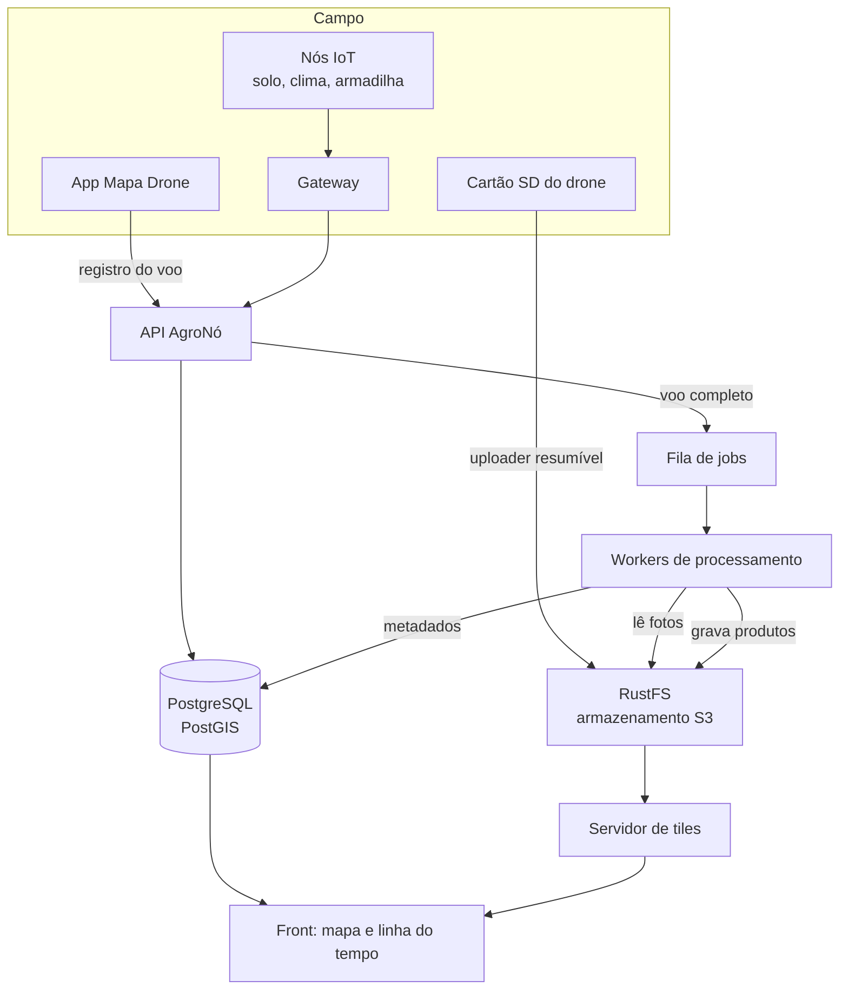
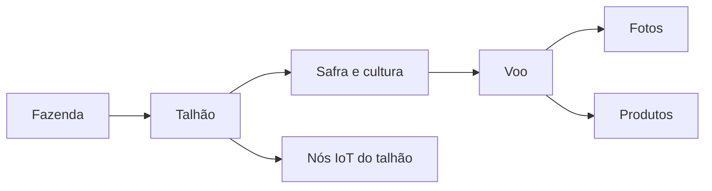
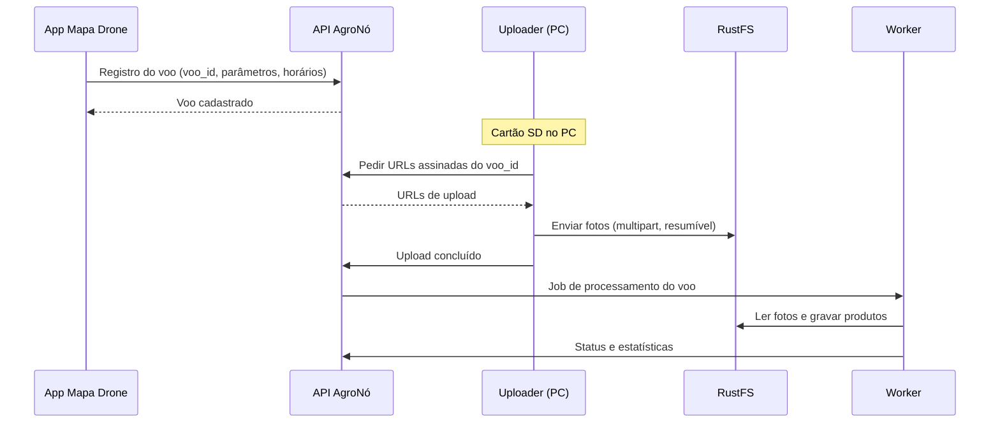

# Pipeline de Imagens

Esta página descreve a **infraestrutura proposta** para receber as fotos do [Drone de Mapeamento](nodes/drone-mapping.md), organizá-las, processá-las e mostrar a evolução das lavouras. Tudo aqui é **proposta de arquitetura**, ainda não implementada.

A ideia é reaproveitar o que o AgroNó já tem (API, banco, dashboards) e acrescentar o que falta para dados de imagem: armazenamento de objetos, fila e workers de processamento.

## Visão geral



## Componentes

| Componente | Opção | Papel |
|---|---|---|
| Armazenamento | RustFS (compatível com S3) | Fotos originais e produtos finais |
| API | A mesma API do AgroNó | Cadastro de talhões e voos, URLs de upload assinadas, status dos jobs |
| Banco | PostgreSQL com PostGIS | Talhões (polígonos), voos, fotos, produtos e medidas |
| Fila | RabbitMQ, NATS ou Redis | Dispara o processamento quando o upload termina |
| Workers | NodeODM (OpenDroneMap) em contêineres | Ortomosaico, modelo digital de superfície, nuvem de pontos |
| Pós-processamento | Python (rasterio, GDAL) | Índices de vegetação, recortes por talhão, estatísticas |
| Modelos de IA | Python (PyTorch, Ultralytics) | Contagem de plantas, falhas, cobertura |
| Tiles | TiTiler lendo GeoTIFFs otimizados (COG) | Mapas rápidos sem pré-gerar imagens |
| Front | React com MapLibre | Mapa, linha do tempo e comparação entre datas |

## Organização dos dados

### Hierarquia agronômica



### Estrutura no armazenamento

```text
agrono-drone/
  fazenda_x/
    talhao_a/
      2026-11-02_001/
        originais/      DJI_0001.JPG ...
        voo.json        registro do app
        produtos/
          ortomosaico.cog.tif
          dsm.cog.tif
          vari.cog.tif
          contagem_plantas.geojson
          estatisticas.json
```

### Tabelas novas

```sql
CREATE TABLE talhoes (
    id SERIAL PRIMARY KEY,
    fazenda VARCHAR(100),
    nome VARCHAR(100),
    geometria GEOMETRY(Polygon, 4326),
    cultura VARCHAR(50)
);

CREATE TABLE voos (
    voo_id VARCHAR(30) PRIMARY KEY,
    talhao_id INTEGER REFERENCES talhoes(id),
    node_id VARCHAR(50),
    iniciado_em TIMESTAMP,
    finalizado_em TIMESTAMP,
    parametros JSONB,
    fotos_esperadas INTEGER,
    fotos_recebidas INTEGER DEFAULT 0,
    status VARCHAR(20)
);

CREATE TABLE produtos (
    id SERIAL PRIMARY KEY,
    voo_id VARCHAR(30) REFERENCES voos(voo_id),
    tipo VARCHAR(30),
    caminho TEXT,
    estatisticas JSONB,
    criado_em TIMESTAMP DEFAULT NOW()
);
```

## Chegada das fotos

O Mavic Pro grava no cartão SD. Baixar centenas de fotos pelo controle remoto é lento e instável, então o caminho recomendado é híbrido:



O uploader associa as fotos ao voo pelo **horário do EXIF**, dentro da janela de início e fim do registro do voo.

## Endpoints propostos

| Método | Rota | Descrição |
|---|---|---|
| POST | `/api/voos` | Registra um voo (vindo do app) |
| POST | `/api/voos/{voo_id}/uploads` | Devolve URLs assinadas para enviar as fotos |
| POST | `/api/voos/{voo_id}/concluir` | Marca o upload como completo e dispara o job |
| GET | `/api/voos/{voo_id}` | Status do voo e do processamento |
| GET | `/api/voos/{voo_id}/produtos` | Lista os produtos gerados |
| GET | `/api/talhoes/{id}/serie` | Série temporal de índices do talhão |

## Processamento

1. **Validar** as fotos (quantidade, EXIF, GPS) contra o registro do voo.
2. **Gerar o ortomosaico** e o modelo digital de superfície com o OpenDroneMap.
3. **Converter** os resultados para GeoTIFF otimizado (COG).
4. **Calcular índices** de vegetação visíveis (VARI, GLI, ExG).
5. **Recortar pelo polígono do talhão** e calcular estatísticas (média, desvio, percentis).
6. **Rodar modelos de IA** nos blocos do ortomosaico (veja [Pesquisa](pesquisa-drone.md)).
7. **Gravar produtos e metadados**, atualizando o status do voo.

O OpenDroneMap exige bastante CPU e memória (a ordem de grandeza é de 8 vCPU e 16 GB para algumas centenas de fotos). Cada job roda isolado e com limites de recursos.

## Front: evolução ao longo do tempo

- Mapa do talhão com o ortomosaico de cada voo.
- **Linha do tempo** para trocar de data e comparar lado a lado.
- Camadas: ortomosaico, índice de vegetação, falhas e contagem de plantas.
- **Gráfico da série temporal** do índice médio por talhão durante a safra.
- **Cruzamento com os nós IoT**: sobrepor chuva, temperatura e umidade do solo à evolução do índice, o que dá sentido agronômico à imagem.

## Fases de construção

| Fase | Entrega | Infraestrutura |
|---|---|---|
| 1 | Validar o voo com o app | Só o celular |
| 2 | Processar um voo e visualizar | WebODM e QGIS no PC |
| 3 | Pipeline automatizado | Docker Compose: API, RustFS, PostgreSQL, NodeODM |
| 4 | Front com linha do tempo | Acrescenta tiles e interface web |
| 5 | Escala | Kubernetes com workers em pods, se for necessário |

Para a pesquisa, as fases 1 e 2 já bastam. As demais só valem a pena se a plataforma for objeto de estudo ou for ser usada por mais pessoas.

## Limites

- Câmera RGB: índices relativos, sem NDVI real.
- Alinhar voos de datas diferentes exige pontos de controle no solo ou boa precisão de GPS.
- Em lavoura real o voo é mais alto (de 20 a 120 m), então o número de fotos e o tempo de voo mudam bastante em relação ao teste a 8 m.
