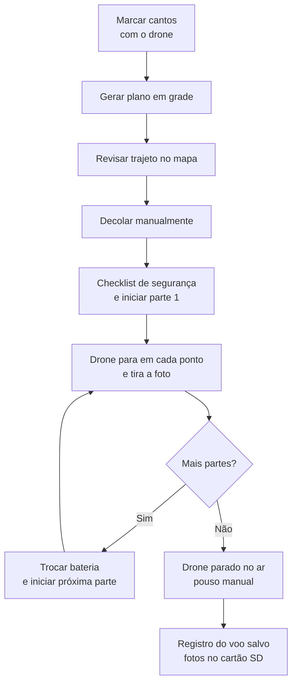

---
sources:
  - drone-pipeline
  - index
  - pesquisa-drone
  - teoria-mapeamento
---
# Drone de Mapeamento (Nó Aéreo)

O drone de mapeamento é um nó **móvel** do AgroNó. Ao contrário dos outros nós, ele não é um ESP32 fixo no campo: é um VANT (DJI Mavic Pro) controlado por um aplicativo Android próprio, o **Mapa Drone**, que planeja o voo em grade, dispara as fotos e registra cada voo.

Os dados dele são **volumosos e esporádicos** (centenas de fotos por voo, alguns voos por semana ou mês), enquanto os outros nós enviam poucos bytes com frequência. Por isso ele não usa o rádio NRF24/LoRa: usa o celular (Wi-Fi/4G) e envio em lote.

:::info Estado atual
O aplicativo compila, o gerador de grade tem 8 testes automatizados passando e o APK foi gerado. **Ainda não foi testado em voo com o drone real.** Veja [Como validar](#como-validar-o-voo).
:::

## Comparação com os outros nós

| Característica | Nós ESP32 | Drone de mapeamento |
|---|---|---|
| Posição | Fixa no campo | Móvel |
| Controlador | ESP32 | Celular Android + controle remoto |
| Comunicação | Rádio NRF24 ou LoRa | USB até o controle, Wi-Fi/4G para a nuvem |
| Tamanho dos dados | Bytes (JSON curto) | Centenas de fotos (GB) |
| Frequência | Minutos ou horas | Por voo |
| Energia | Painel solar e deep sleep | Bateria do drone, cerca de 20 min de voo útil |
| Evento | Leitura ou contagem | Voo concluído |

## Hardware

- **Drone**: DJI Mavic Pro (primeira geração)
- **Câmera**: sensor 1/2,3", 12 MP (4000 x 3000), RGB. Não é multiespectral
- **Gimbal**: apontado a -90 graus (câmera para baixo) durante o mapeamento
- **Controle remoto**: com cabo USB ligado ao celular
- **Celular**: Android (de preferência 8 a 11, por causa do SDK v4 da DJI)
- **Armazenamento**: cartão microSD do drone (as fotos ficam nele)

## Aplicativo Mapa Drone

- **Linguagem**: Kotlin
- **SDK**: DJI Mobile SDK v4.18 (o v5 não suporta o Mavic Pro)
- **Mapa**: osmdroid (OpenStreetMap, sem chave de API)
- **Código**: pasta `Drone/MapaDrone` neste repositório

### O que o aplicativo faz

1. Marca os **cantos da área** com o próprio drone (botão "Marcar canto") ou por toque longo no mapa.
2. Gera o **plano em grade** (linhas paralelas em serpentina), com a sobreposição escolhida.
3. Mostra o trajeto no mapa antes do voo, com número de fotos, distância e tempo estimado.
4. Divide a missão em **partes** de até 95 pontos (o limite do Mavic Pro é 99 waypoints por missão).
5. Executa a missão, com **pausar**, **retomar** e **parar**.
6. Guarda um **registro por voo** (histórico) que pode ser compartilhado em JSON.

### Fluxo de um voo



## Planejamento da grade

A câmera aponta para baixo, em paisagem, com o lado longo da foto perpendicular ao sentido do voo.

- Largura vista no chão = altura x largura do sensor / distância focal
- Comprimento visto no chão = altura x altura do sensor / distância focal
- Distância entre fotos = comprimento visto x (1 menos a sobreposição frontal)
- Distância entre linhas = largura vista x (1 menos a sobreposição lateral)

As linhas externas ficam ligeiramente para dentro da área, de modo que todo ponto da área seja visto por pelo menos duas linhas. Cada linha se estende por uma margem configurável nas duas pontas.

### Exemplo validado: terreno de teste de 12 x 50 m a 8 m de altura

| Item | Valor |
|---|---|
| Cada foto cobre no chão | cerca de 10,4 x 7,7 m |
| Resolução | cerca de 0,26 cm por pixel |
| Sobreposição | 75% frontal e 70% lateral |
| Foto a cada | cerca de 1,9 m |
| Linhas | 4, espaçadas cerca de 2,6 m |
| Fotos por linha | 31 (com 3 m de margem em cada ponta) |
| Total | 124 fotos em 2 partes de 62 pontos |
| Tempo estimado | cerca de 9 minutos |

Esses números são reproduzidos pelos testes automatizados do gerador de grade.

## Voo e segurança

O drone **para em cada ponto**, espera 0,7 s para estabilizar e tira a foto. Isso evita fotos tremidas e respeita o intervalo mínimo de cerca de 2 s entre fotos do Mavic Pro.

O aplicativo só inicia uma missão quando:

- o drone **já está voando** (a decolagem é manual);
- o GPS tem **8 satélites ou mais**;
- a bateria está em **30% ou mais**;
- o primeiro ponto está a **no máximo 150 m** do drone;
- os parâmetros estão em faixas seguras (altura de 3 a 50 m, velocidade de 0,5 a 5 m/s, sobreposição de 50% a 90%).

Antes de iniciar, o aplicativo mostra um checklist (fios, postes, muros, pessoas). Ao terminar cada parte, o drone **fica parado no ar**, sem retorno automático, para o piloto decidir como voltar.

:::warning Cuidados em campo
- A 8 m de altura há risco com redes elétricas de baixa tensão. Mantenha pelo menos 5 m de margem de qualquer obstáculo: o GPS tem erro de 1 a 2 m e o sensor de obstáculos do Mavic Pro só olha para a frente.
- O seletor do controle precisa estar em **P** (GPS) para a missão iniciar.
- Confira se há cartão SD com espaço antes de decolar.
- Configure uma altura de retorno (RTH) segura para o local no aplicativo da DJI.
- Respeite as regras da ANAC e do DECEA.
:::

## Como validar o voo

Teste em etapas, sempre com o controle remoto na mão:

1. **No chão, ligado**: conectar, apontar o gimbal para baixo, marcar cantos.
2. **Missão minúscula** (2 linhas, cerca de 6 pontos) a 15 m, em área livre.
3. **Conferir o cartão SD**: o número de fotos deve bater com os pontos concluídos.
4. Aumentar a área, depois 10 m, e só então 8 m.

## Registro de voo

Cada voo recebe um ID no formato `AAAA-MM-DD_NNN` e é salvo como um arquivo JSON no celular. Ele liga o voo às fotos do cartão SD pelo horário (as fotos do Mavic Pro trazem data, hora e GPS no EXIF).

```json
{
  "id": "2026-11-02_001",
  "startedAt": "02/11/2026 14:05:00",
  "endedAt": "02/11/2026 14:14:30",
  "status": "concluido",
  "altitudeM": 8.0,
  "frontOverlap": 0.75,
  "sideOverlap": 0.70,
  "speedMs": 2.0,
  "corners": [
    { "lat": -15.000000, "lon": -47.000000 }
  ],
  "lineCount": 4,
  "waypointCount": 124,
  "partsTotal": 2,
  "partsDone": 2,
  "photosTriggered": 124,
  "log": []
}
```

A contagem `photosTriggered` é a de pontos concluídos. O total real é conferido no cartão SD.

## Integração com o AgroNó

O drone entra na plataforma como um nó do tipo `drone`, mas conversa com o servidor **direto pelo celular**, sem passar pelo rádio do gateway. O princípio **offline-first** se mantém: o registro fica no celular e é enviado quando houver internet.

Evento enviado à API existente (`POST /api/dados`) quando o voo termina:

```json
{
  "node_id": "DRN_01",
  "tipo": "drone",
  "evento": "voo",
  "voo_id": "2026-11-02_001",
  "talhao": "Campo A",
  "altura_m": 8.0,
  "fotos": 124,
  "timestamp": "2026-11-02T14:14:30",
  "sync": false
}
```

As fotos em si não passam por esse endpoint. Elas seguem o fluxo de upload em lote descrito em [Pipeline de Imagens](../drone-pipeline.md), e o processamento gera produtos (ortomosaico, índices, contagem de plantas) ligados ao `voo_id`.

:::note Proposta
O envio do registro à API ainda não está implementado no aplicativo. Hoje o registro fica no celular e pode ser compartilhado manualmente.
:::

## Limitações

- Câmera **somente RGB**: não gera NDVI real, apenas índices visíveis (VARI, GLI, ExG).
- Exposição automática e falta de calibração radiométrica: os índices são relativos, não absolutos.
- O SDK v4 da DJI é antigo e pode ter problemas em versões novas do Android.
- A altura é relativa ao ponto de decolagem (terreno plano).
- Autonomia de cerca de 20 minutos por bateria: áreas grandes exigem várias partes.

## Próximos Passos

- Validar a missão em voo real (primeiro teste a 15 m)
- Enviar o registro do voo para a API do AgroNó
- Upload das fotos com envio resumível e associação ao voo
- Escolher o talhão cadastrado no AgroNó ao planejar o voo
- Importar o contorno do talhão em vez de marcar os cantos
- Cruzar os produtos do voo com os dados dos nós de solo e meteorologia
