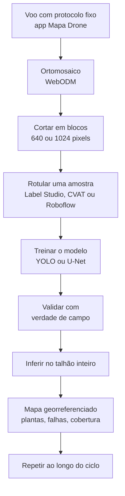

---
sources:
  - drone-pipeline
  - teoria-mapeamento
---
# Pesquisa: IA e Agronomia com Drone

Esta página reúne as ideias para usar o [Drone de Mapeamento](nodes/drone-mapping.md) como instrumento de **pesquisa de mestrado**, aplicando inteligência artificial a imagens de lavoura.

O foco da pesquisa é o **dado agronômico e a validade científica**, não a venda de um produto. Por isso a infraestrutura pode ser enxuta (veja [Pipeline de Imagens](drone-pipeline.md)): Kubernetes, front elaborado e multiusuário só entram se a plataforma em si for objeto de estudo.

:::note Em aberto
Ainda precisam ser definidos: a área de concentração do mestrado, a cultura e a época de plantio disponíveis, e se o foco é o dado agronômico ou o sistema.
:::

## Stack enxuta para pesquisa

| Para um produto | Para a pesquisa |
|---|---|
| Kubernetes, fila, API, front | WebODM em Docker no PC ou em servidor da universidade |
| RustFS | Pastas organizadas por cultura, talhão e data |
| PostGIS e API | Planilha ou SQLite com voos, parcelas e medidas de campo |
| Servidor de tiles e front | QGIS para visualizar, comparar datas e extrair estatísticas |
| Workers de índices | Scripts em Python (rasterio) calculando VARI, GLI e ExG por parcela |

## Tarefas de IA viáveis com câmera RGB

| Tarefa | Técnica | Dificuldade | Observação |
|---|---|---|---|
| Contagem de plantas e estande | Detecção de objetos (YOLO) | Baixa a média | Muito presente na literatura e fácil de validar com contagem manual |
| Falhas de plantio | Detecção ou segmentação | Média | Deriva da contagem e do alinhamento das linhas |
| Cobertura vegetal e solo exposto | Segmentação (U-Net, SAM) ou classificação por pixel | Baixa | Boa para mostrar evolução ao longo do ciclo |
| Plantas daninhas | Segmentação semântica | Média a alta | Exige voo baixo e muitos rótulos |
| Doenças e estresse | Classificação | Alta | O RGB só mostra sintomas já visíveis |
| Produtividade e biomassa | Regressão | Alta | Exige muita verdade de campo |

## Culturas mais fáceis para começar

Plantas visíveis e separadas, bom contraste com o solo e ciclo curto:

- **Milho** nas fases iniciais (V2 a V6): plantas espaçadas em linha, o melhor caso para contagem.
- **Soja** nas fases iniciais: em linha, porém mais fechada que o milho.
- **Hortaliças** (alface, repolho, couve): plantas individuais bem definidas e ciclo curto.
- **Mudas** em viveiro ou cana nova: contagem de mudas.

Culturas de dossel fechado (arroz, trigo adulto) dificultam separar plantas individuais.

## Altura de voo

A 8 m de altura cada pixel mede cerca de 2,6 mm: ótimo para detalhe, mas inviável para talhões grandes. Para contagem de plantas, de 20 a 30 m (cerca de 0,7 a 1 cm por pixel) costuma ser um bom compromisso. A altura e a sobreposição são parâmetros do aplicativo, o que o torna também uma **ferramenta experimental**: dá para variar esses fatores e medir o efeito na qualidade do resultado.

## Fluxo de trabalho

## Protocolo e validade científica

1. **Verdade de campo**: sem medida real não há validação. Exemplos: contagem manual de plantas em parcelas, altura, SPAD (clorofila), biomassa, produtividade.
2. **Pontos de controle no solo (GCPs)**: alvos com coordenadas medidas por um GPS melhor que o do drone, para alinhar voos de datas diferentes.
3. **Protocolo de voo fixo**: mesma altura, sobreposição, velocidade e horário (perto do meio-dia), com condição de céu semelhante. O aplicativo guarda esses parâmetros em cada voo, o que ajuda na **reprodutibilidade**.
4. **Painel de referência de cor**, se possível, para reduzir o efeito da variação de iluminação.
5. **Repetição** de voos ao longo do ciclo da cultura.

## Limitações a registrar na metodologia

- Câmera **somente RGB**: sem NDVI real. Os índices RGB (VARI, GLI, ExG) são válidos e muito usados, mas medem outra coisa.
- **Exposição automática**: muda entre fotos e voos. Se possível, fixar a exposição no aplicativo da DJI antes do voo.
- **Sem calibração radiométrica**: os índices são relativos, não absolutos.
- **Obturador rolling shutter**: reduz a precisão geométrica em voo contínuo. O voo do aplicativo para em cada ponto, o que ajuda.
- **Equipamento antigo**: o Mavic Pro e o SDK v4 não recebem atualizações.

Documentar essas limitações faz parte do trabalho e não invalida a pesquisa.

## Métricas de avaliação

| Tarefa | Métricas |
|---|---|
| Detecção (contagem de plantas) | Precisão, recall, F1, mAP e erro absoluto médio da contagem por parcela |
| Segmentação (cobertura, daninhas) | IoU, F1 por classe |
| Regressão (altura, biomassa) | R2, RMSE, erro absoluto médio |

## Ferramentas

- **Modelos**: YOLOv8 ou YOLO11 (Ultralytics) para detecção, U-Net e SAM (Segment Anything) para segmentação.
- **Rotulagem**: Label Studio, CVAT, Roboflow.
- **Pouco dado**: um YOLO pré-treinado com algumas centenas de plantas rotuladas já costuma dar resultado.
- **Conjuntos públicos** para comparação: buscar por contagem de plântulas de milho e detecção de plantas daninhas por VANT no Roboflow Universe e no Kaggle.
- **Imagens grandes**: treinar e inferir em blocos do ortomosaico e remontar o resultado com coordenadas.

## Ideias de pergunta de pesquisa

- Avaliação de modelos de detecção de objetos em imagens RGB de VANT de baixo custo para **contagem de plantas e identificação de falhas de plantio** em uma cultura.
- **Evolução da cobertura do solo e do vigor** ao longo do ciclo com índices RGB, comparada com medidas de campo.
- **Altura de plantas** estimada pelo modelo digital de superfície, validada em campo.
- **Efeito da altura de voo e da sobreposição** na qualidade do mosaico e na acurácia da contagem.
- **Cruzamento com o AgroNó**: relacionar a evolução do índice de vegetação com chuva, temperatura e umidade do solo medidos pelos nós IoT. Essa ligação diferencia o trabalho, porque une sensoriamento remoto e sensores em campo na mesma plataforma.

## Próximos passos

1. Definir a pergunta de pesquisa, a cultura e o ciclo.
2. Validar o voo com o aplicativo (primeiro teste a 15 m).
3. Voar um talhão e processar o ortomosaico no WebODM.
4. Escolher e rotular uma amostra, treinar o primeiro modelo.
5. Planejar as parcelas de verdade de campo e os pontos de controle.
